# Hola, este es mi shader ;p

como paso?-estaba en mi habitacion jugando cuando de repentre un shader que estaba usando 
presento tirones en la pantalla y se me crasheo el juego :v, entonces me dije a mi mismo:
porque no me hago un shader? y he aqui mi shader, inspirado en muchos de la comunidad, 
espero que disfrutes mucho este shader !! 
Todo el menú está en español.

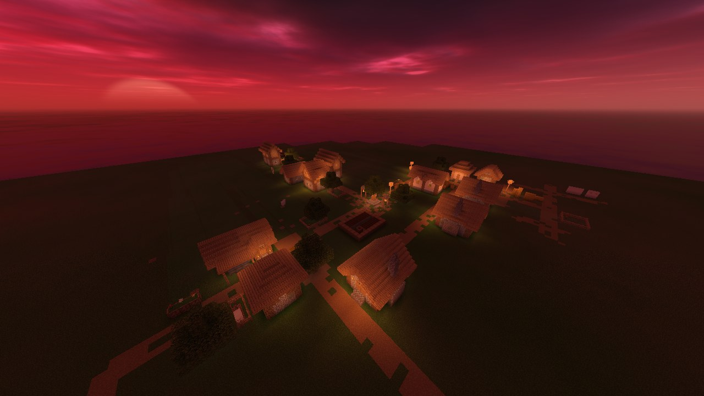

## Instalación

1. Descarga **[NoName-Shader-v1.0.zip](../../raw/main/NoName-Shader-v1.0.zip)**. No lo descomprimas.
2. Pégalo en la carpeta de shaders: pulsa `Win + R`, escribe `%appdata%\.minecraft\shaderpacks` y Enter.
3. En el juego ve a *Opciones → Calidad de video → Shaders*, elige **NoName-Shader** y listo.

En el menú del shader puedes elegir la calidad: **Bajo**, **Medio** o **Máximo** (con sombras).

## Requisitos

- Minecraft **26.1.2** con **Fabric**
- **Iris** y **Sodium** (no funciona con OptiFine)

## Galería

### Superficie

| | |
|---|---|
|  | 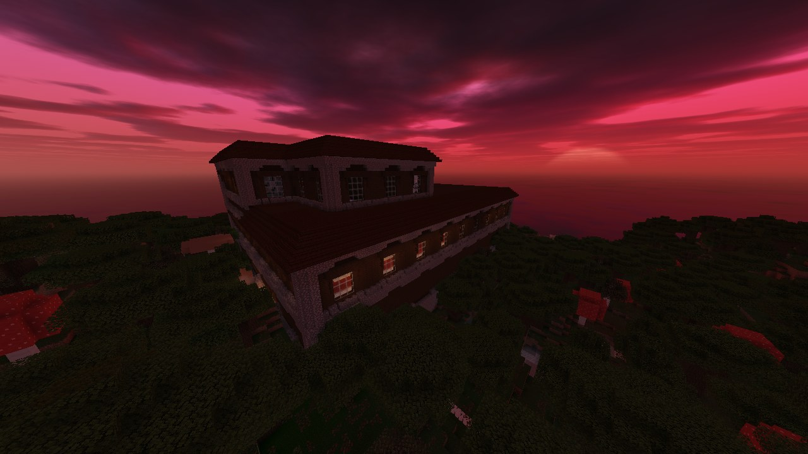 |
| 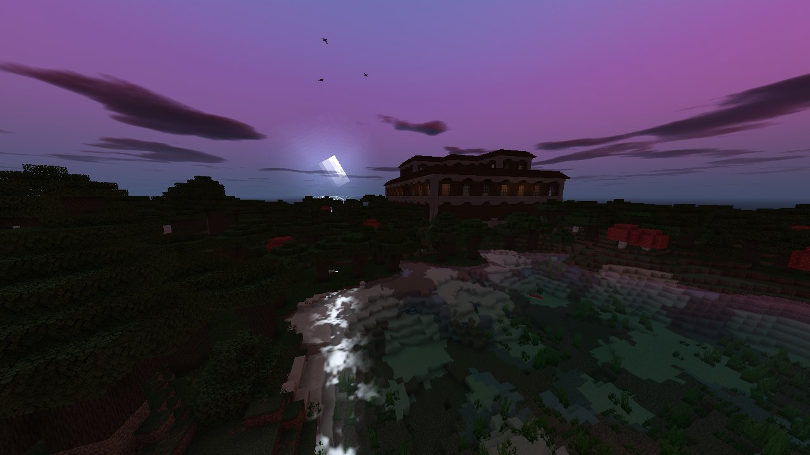 | 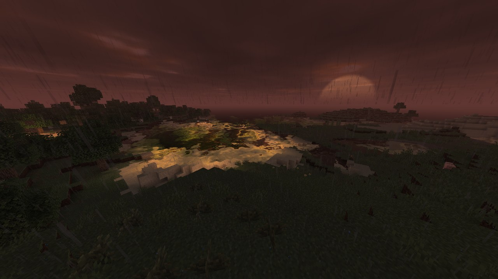 |
| 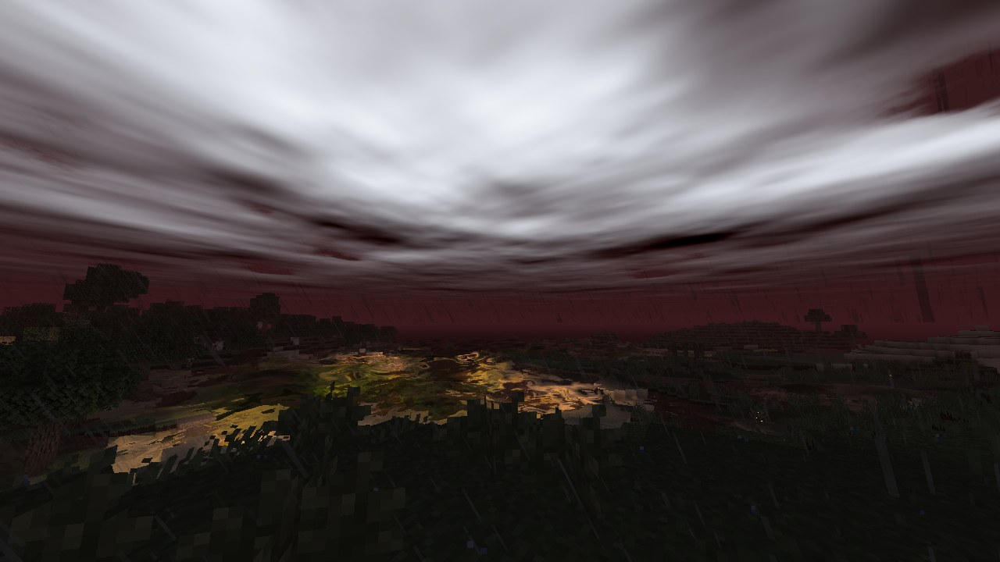 | 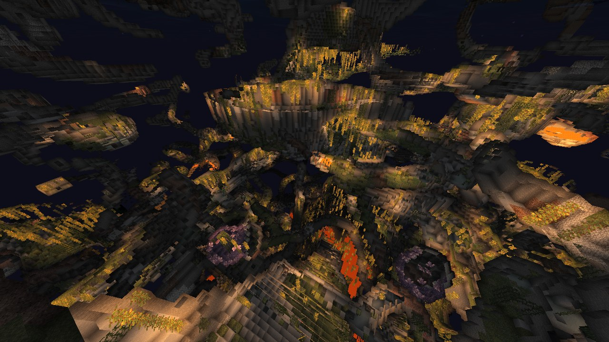 |
| 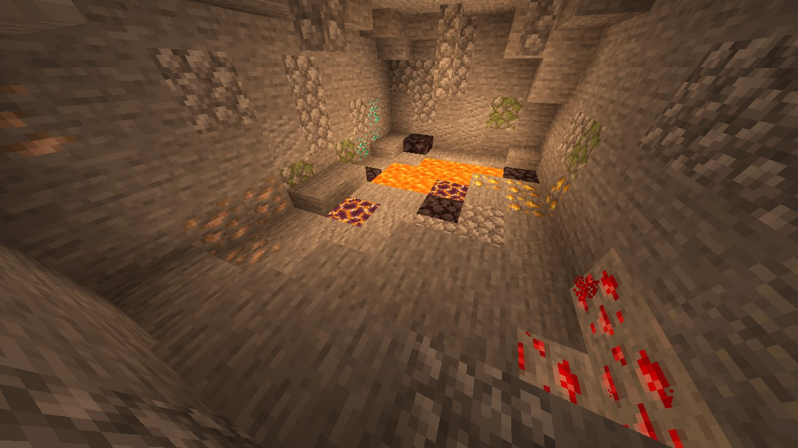 | |

### Interiores y sombras

| | |
|---|---|
| 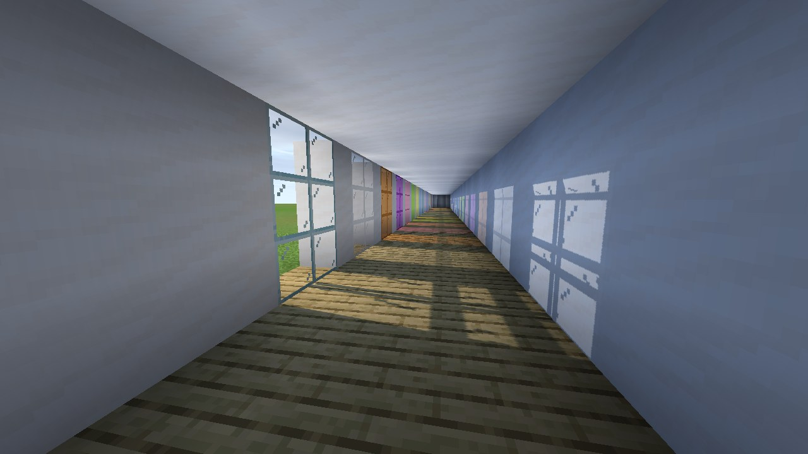 | 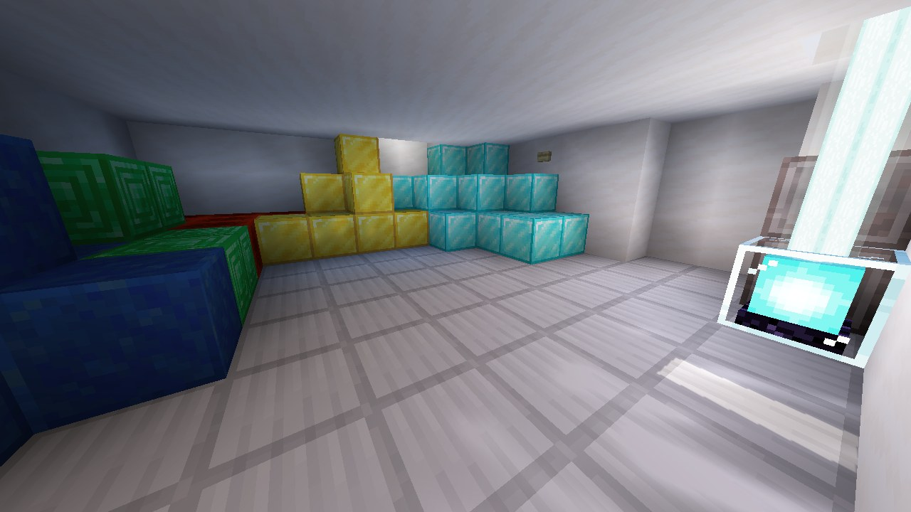 |
| 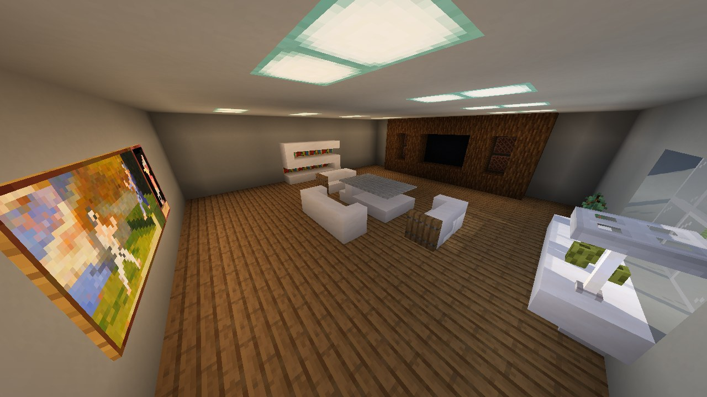 | 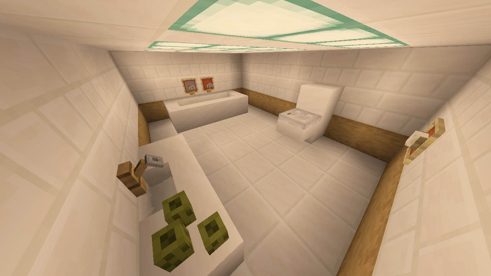 |

### Nether

| | |
|---|---|
| 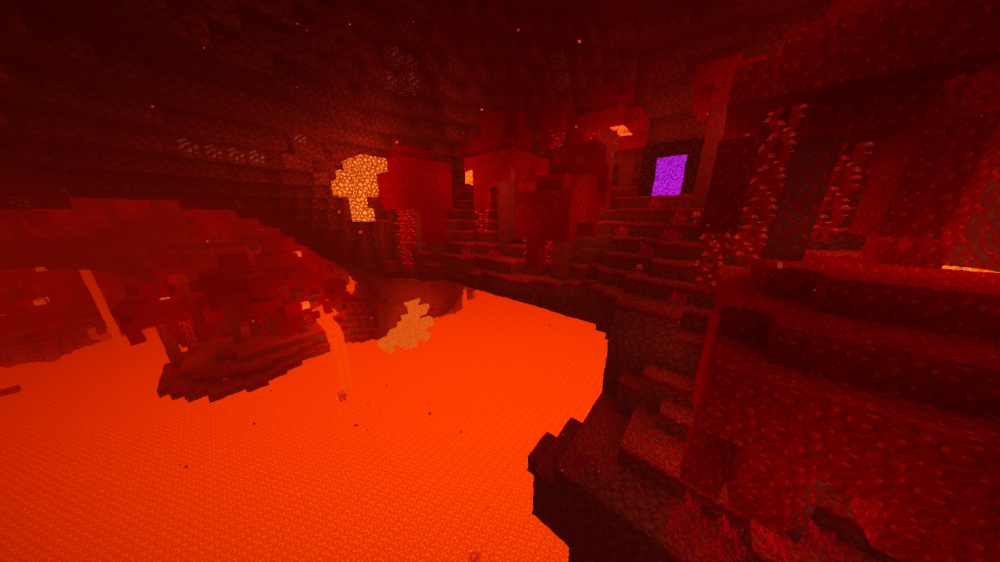 | 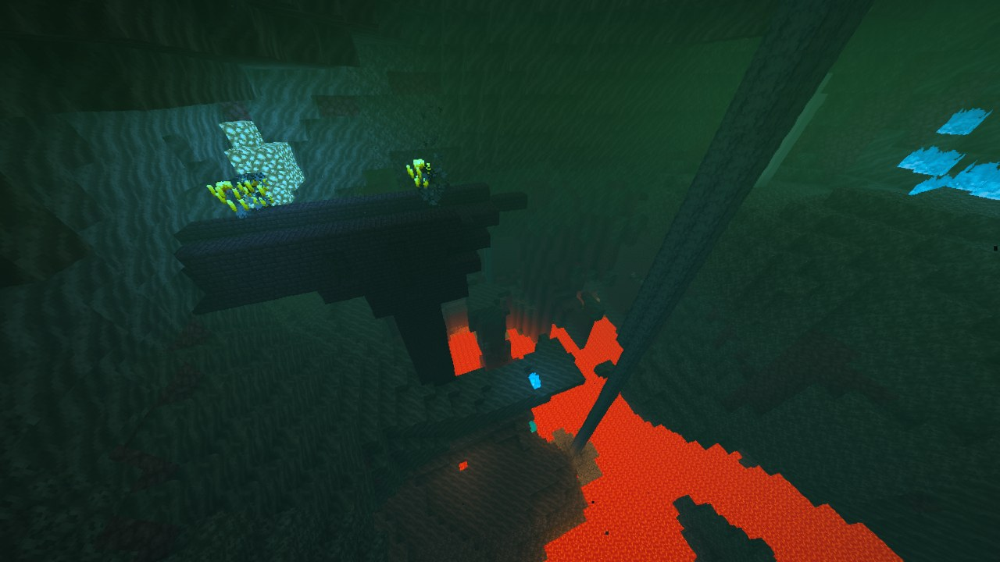 |

### End

| | |
|---|---|
| 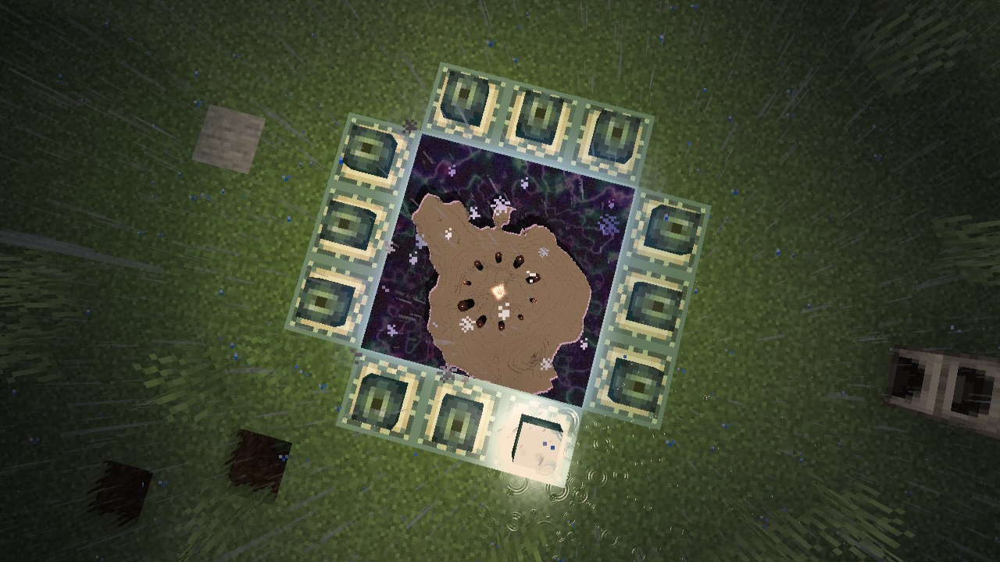 | 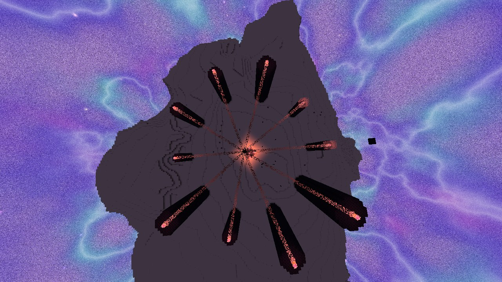 |
| 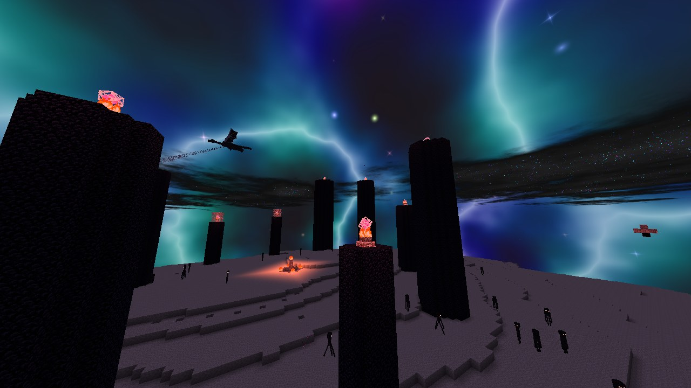 | 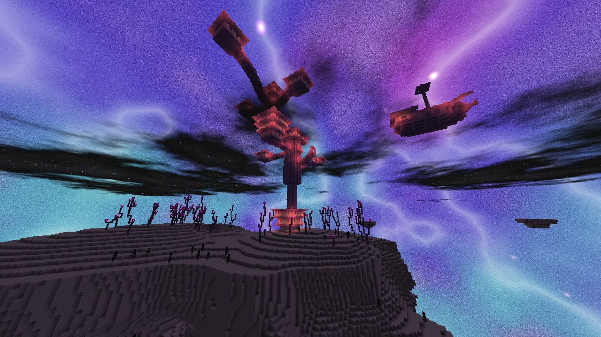 |
| 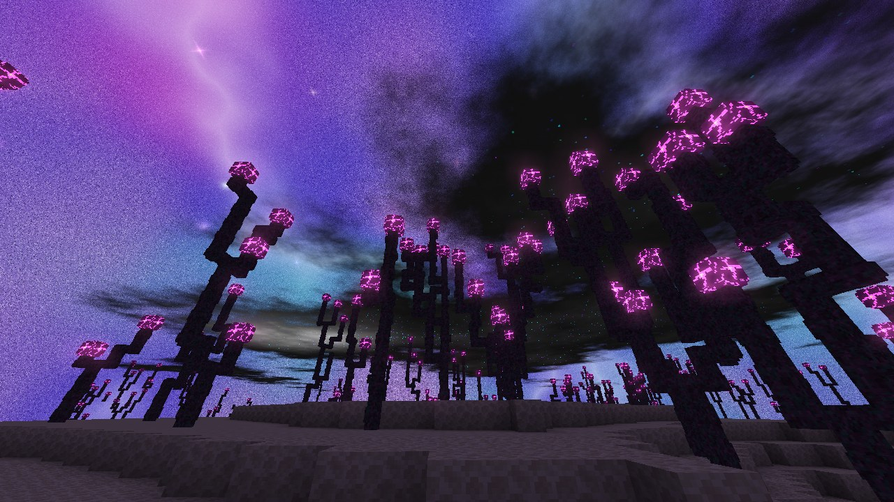 | |

## Qué tiene

- Agua clara, con el reflejo del sol y un camino de luz de la luna
- Mar de tormenta con olas grandes, y el barco sube y baja con ellas
- Atardeceres intensos, sol redondo y amanecer animado
- Nubes 3D y rayos que iluminan el cielo
- Charcos, suelo mojado y nieve que se acumula
- Sombras con luz de colores a través del vidrio tintado (Máximo)
- Minerales y cuarzo que brillan, y luz de la antorcha en la mano
- Optimizado para gráficas integradas

## Créditos

Basado en mi vision del minecraft, lol ;p

## Licencia

[MIT](LICENSE)
